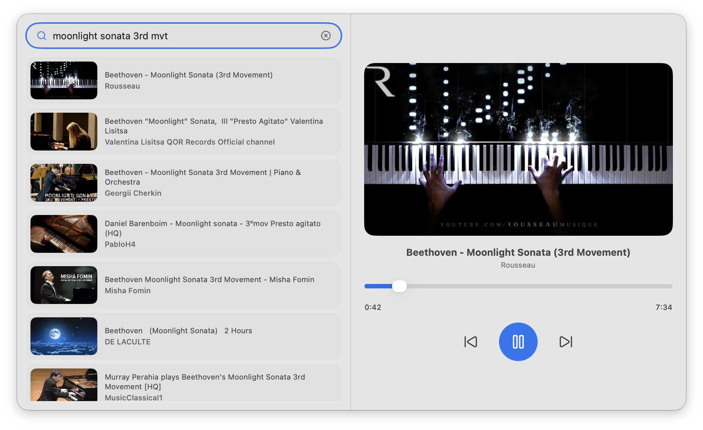

# 🎧 Tunaa

### YouTube, without the video.

Tunaa is an audio-first YouTube listening experience for macOS. Search
for the music, performances, podcasts, and other content you love, then
enjoy the sound without needing to keep the video front and center.



## ✨ Features

- **YouTube search** --- Find music, performances, podcasts, and more.
- **Rich search results** --- Browse results with video thumbnails,
  titles, and channel names.
- **Audio-first listening** --- Keep the focus on listening rather
  than watching.
- **Playback controls** --- Control playback with play/pause and
  previous/next buttons.
- **Playback progress** --- See the current position and total
  duration.

## 🖥️ Requirements

- macOS 13 (Ventura) or later
- Swift 5.10 or later
- Xcode Command Line Tools

## 🚀 Getting Started

### Clone the repository

```bash
git clone https://github.com/kicetwigs/tunaa.git
cd tunaa
```

### Build the app

Run the included build script:

```bash
chmod +x build.sh
./build.sh
```

The script builds and packages the macOS application. When the build
completes, open `Tunaa.app`:

```bash
open Tunaa.app
```

## 🛠️ Built With

- **Swift** --- Application development
- **Swift Package Manager** --- Build and dependency management
- **WKWebView** --- Web content integration

## 📁 Project Structure

```text
tunaa/
├── Packaging/       # macOS application packaging
├── Sources/
│   └── Tunaa/       # Application source code
├── design/          # Design assets
├── Package.swift    # Swift package configuration
└── build.sh         # Build and packaging script
```

## 🤝 Contributing

Contributions, bug reports, and feature ideas are welcome!

1.  Fork the repository.
2.  Create a branch for your change.
3.  Make your changes and test them.
4.  Open a pull request with a clear description.

For larger changes, opening an issue first is a good way to discuss the
approach.

## 📄 License

No license information is specified in this README. Check the repository
for the current license before reusing or redistributing the project.

---

Made with ❤️ for people who just want to listen.
